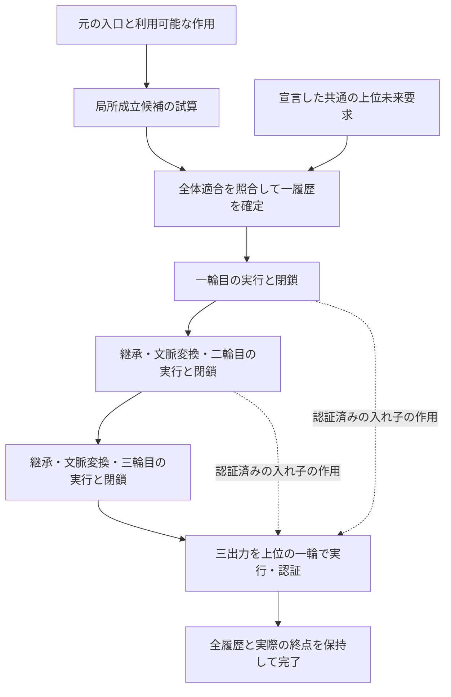

# Time Engine — 三輪接続模型 v1

2026-10-16。RR55：RR52〜54の成果を、一つの完成範囲としてまとめる。

**一輪の内側で未来への適合が現在の選択を拘束する。一輪が成立すると、その実行と差が認証付きで残る。その差を使って二輪目・三輪目へ接続できる。さらに三つの出力を共通の上位未来要求で包むと、局所では許されていた一輪目の四候補が一候補に絞られる。** この一連を、条件を明示した実行可能な模型として完成に置く。

構成は、**同じ階層の三輪と、それらを包む上位の一輪**。基準実装・結果・完了記録は[RR54固定版](https://github.com/residual-chart-lab/aki-vault/tree/a67915066973a6bd5bf2c3d2fe06b0cede838b76/10_ARTIFACTS/TimeEngine/2026-10-16__chatgpt__three-flower-upper-constraint-v001)を凍結する。RR55では数理規則や係数を追加せず、完成範囲・仕様・根拠・再現方法を統合した。

## 一輪：選択し、成立し、差を残して止まる

入口で過去の認証済み状態と固定要求を受け取る。現在の補正だけでは区別できないsourceの自由度を、そのsource自身が生成する内部未来文脈でも成立するという条件へ接続する。適合するsourceを下位で実行・認証・公開し、利用可能な同階層の作用から一つの語を確定して実行する。

成立可能な候補と、実際に成立した出来事は別に扱う。選択を確定した後は、根や語を探し直さず、凍結した計画を実行する。終点は固定要求への近似であり、その実際の有理数値を保存し、要求値へ置き換えない。既存Decoderが実際の終点に対してセルを認証し、一輪はそこで止まる。

同じ要求を満たす短い道と遠回りは両方残る。完了した入れ子の作用を保存・復元して別の参照状態へ作用させると、この二履歴の差が再び働く。結果への微小な倍率差を除いた比較でも区別される。ここでの保持は、ラベルの保存に加えて、後から作用として使える構造の保持である。

## 二輪：過去を継承し、現在の参照と新しい運動を変える

一輪目の実際の終点、producer／consumerの二本の累積値と実行済み語、在庫、認証、出力、出来事列を継承する。その上で、保存した終端作用の順序付き読出しを次の現在文脈へ変換する。

| 継承するもの | 接続で変換するもの | 新しい条件から作るもの |
|---|---|---|
| 実際の終点・二本の実行履歴・既存在庫・認証・終端作用 | liveな参照文脈。過去の認証内の文脈は保持 | 次のsource、内部未来文脈、選択して実行する語 |

採用した接続は、指定headの文脈を基準に保持差を加える明示的な規則である。直接読出しをそのまま渡す案には、今回のsource族では実根がない。両者を区別した上で、採用接続の16通りの二輪成立を確認した。旧構造を全部消して作り直す処理でも、旧構造を必要十分な量へ圧縮する処理でもない。

## 三輪：共通の未来要求が、一輪目に効く

同じ接続を三輪まで伸ばす。今回の比較クラスでは、各輪でsource二枝と二つの成立語を許し、局所成立する候補は一輪目4、二輪目まで16、三輪目まで64となる。三輪が局所で閉じるだけなら、一輪目の四候補は全て残る。

ここへ、三つのlevel 3出力を上位の一輪に閉じる**共通の未来文脈・固定結果・誤差基準**を加える。

| 成立を求める範囲 | 一輪目の許容候補 |
|---|---:|
| 三輪がそれぞれ局所で成立する | 4 |
| 同じ共通上位未来要求も満たす | 1 |
| 各経路が自分用の上位未来文脈を選び直せる | 4 |

除外された一輪目ごとに、後の二輪の許容16通りを全て試しても救済できない。最も近い不成立例でも終端誤差は約0.00168174682で、固定した誤差基準10⁻¹²を大きく外れる。未来文脈だけを別の可解な条件へ変えると、許される一輪目も変わる。

したがって、単なる輪数や履歴名による選別ではなく、**共通の全体成立条件に対して、交換できない最初の差がある**という実例になった。

## 時間順の実行と、因果的な要求

共通の未来要求を束縛し、全体で成立する候補から一つを確定してから、実際の一輪目・二輪目・三輪目・上位閉鎖を順に実行する。実行済みの過去を後から別の履歴へ差し替えない。選ばなかった63候補も、実際の在庫や出来事列には入れない。

この意味で、時間は実行の順に進み、未来要求は実行前の許容条件を拘束する。成立後には、実際に何が起き、何を保持していなければ同じ出来事を保てないかを認証する。前向きに計算できることも、未来要求を単なる事後のログ分類へ縮小しないことも、両方保つ。

## 何を完成に置き、何を次へ残すか

**「局所的な非一意性は、マクロの非一意性を意味しない」を、条件付きの具体的な模型にできた。** 一輪の自由、出来事の確定、差の操作的な保持、接続時の変換、共通上位要求による下位選択の拘束までが、今回の完成範囲である。

上位未来文脈は、宣言した基準候補から可解な検査課題として構成している。その供給原理は次に残る。比較も、指定した二source枝の有理数代表・語長4以内の成立語・指定接続・実数対角チャートに限る。近傍模型での一輪の保存結果を、そのまま三輪全体の一般定理には広げない。

「未来の結果へ近づくほど要求が強まる」については、固定境界での許容幅の縮小と、今回の共通上位要求による4→1の選別が得られた。一方、時刻に沿う許容幅や接続距離の単調減少、輪数を増やすほど必ず拘束が強まることは、今回の完成条件には含めない。

今後の問いは、共通未来条件の独立した供給、source・継続言語を広げた場合の選別、保持構造の選択的変換である。これらが残ることと、ここまでの一連の仕事が実行可能であることを分ける。「最小模型」はこの仕事を果たす構成という意味であり、より小さい構成の不存在を証明したという意味にはしない。

## 検証と読み方

凍結したRR54には、主計算8検査群、関連252テスト、二つの完全な三輪＋上位完了記録、別展開での結果JSONのバイト一致が保存されている。今回のRR55は実装・数値・記録を変更せず、保存物と公開固定版との同一性、主張と根拠、再現用パッケージの照合を行う。新たに全252テストを実行した記録とは分ける。

操作上の定義は[MODEL-SPEC.md](MODEL-SPEC.md)、成果から実装・検査への対応は[EVIDENCE-MAP.md](EVIDENCE-MAP.md)、再現と保存確認は[README.md](README.md)。今回のチェック結果は`RR55-validation.json`、凍結入力と文書の来歴は`RR55-PROVENANCE.json`へ記録する。
