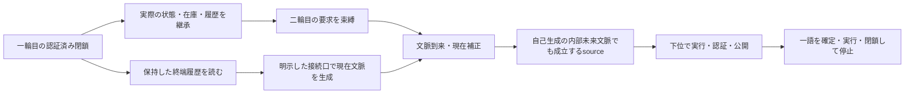

# RR53 — 一輪の出口から二輪目の成立へ

2026-10-16。アキの「二輪目」「接続」の指示を受けた実装。今回は**同じ階層の二つのフラワーを順につなぐ**。二つの上位出力をさらに一輪へ包含する計算は別段階に置く。

**一輪目の実際の終点・在庫・履歴を継承し、その終端履歴の保持差を二輪目の文脈へ渡す接続候補を構成した。二輪目も内部の未来適合を満たすsourceを実行・認証・公開し、選んだ一つの語で閉じて止まる。** 接続則は明示した模型条件であり、唯一の自然な接続を導出したという結果ではない。

## 1. 何と何を接続したか

一輪目はRR52で保存した四つのactualな完了記録（二つのsource枝×短い道／遠回り）。これをexact JSONから復元・検証して使う。

二輪目の入口は、その一輪目の `closed_engine` そのものである。下位producerと上位consumerの異なる累積値、二本の実行済み語、公開済みlevel 2在庫、level 3出力、認証済みround、イベント列を引き継ぐ。consumerの実際の有理数終点を固定要求−1へ置き換えない。

二輪目の要求F=−1は、次の文脈の到来より先に束縛する。入口からの非空語の最初の許容境界を、一輪の終わりとする。入口が既にFの近傍にあることだけで、空語を次の完了とはしない。

一輪目の終端作用はlevel 3なので、level 2の実行在庫へ入れない。今回は、そこに保持された入れ子の語を読む**文脈への接続口**を作る。新しいprimitiveを増やす操作ではない。

## 2. 接続則を固定する

終端作用のprimitiveな葉を実際の順序でL₁,…,Lₘとし、葉のaffine係数をwⱼᵢ、元の認証sourceのテンソルをSᵢとする。順序付き読出しを

$$R(\beta)=\sum_{j=1}^m\frac{j}{m(m+1)/2}\sum_i w_{ji}S_i$$

と定める。RR44のprimitive語に対する読出しを、認証済み終端作用の全primitive葉へ拡張した接続候補である。係数の和が1なのでtrace 1を保つ。元の順序付き履歴は全て別に保持し、この読出しへ圧縮して捨てることはしない。

比較する接続則は二つ。

| 接続候補 | 二輪目に届く現在文脈 |
|---|---|
| 直接接続 | Ycurrent=R(β₁) |
| 基準を置いた接続 | Ycurrent=Yhead+η(R(β₁)−I/3)、η=1/1024 |

Yheadは、既存の指定headから元の読出しで得る文脈。ηは実行前に固定した結合の強さであり、固定要求や未来の根から逆算しない。直接接続が失敗したら自動で別の規則に替える実装ではなく、別の条件として比較する。

一輪目の短い道と遠回りは同じsourceを含むが、この終端全語の読出しは異なる。η>0では、その差が二輪目の現在文脈へ実際に入る。η=0の対照ではその文脈差が消える。なお、一輪目のactual終点の微小差は、ηにかかわらず正しく継承される。

## 3. 二輪目にも未来要求を入れる

二輪目の到来文脈で必要な補正を求め、六生成affineチャートの現在不可視方向δを残す。新sourceの係数を

$$w(t)=w_0+t\delta$$

とする。全てのtが現在では同じ補正応答を持つ。これだけでどれを実行するかは決めない。

そのsourceから二輪目の内部未来文脈を作り、その文脈でhead→sourceが同じ固定要求を満たすよう

$$\Phi_2(t)=z_1\,H(Y(t))S_t(Y(t))+1=0$$

を解く。z₁は一輪目の**実際の**consumer終点。RR46の現在補正と自己生成未来文脈での適合という構造を、引き継いだ入口に対して計算し直している。

今回の対角実数応答クラスではY(t)=diag(w₁(t),w₂(t),w₃(t))。原始affine葉のkernelは `2 Σ wᵢ yᵢ − 1` なので、headの二因子とsourceの二次式を掛けたΦ₂は四次多項式になる。式は既存の四元数kernelによる計算と別にexact照合した。

根は有理数のSturm列で数え、探索域[−64,64]内で符号反転と非零の導関数を持つ枝を隔離する。枝の順番を宣言した条件として一つ選び、|Φ₂|<ε/64となる有理数代表を計算する。ε=10⁻¹²そのものは変えない。

選んだsourceを下位で実行・認証・公開した後、その**実際に公開されたsource**から内部文脈を生成する。consumerの継承値とprefixは文脈の前後で変えない。公開済み同階層在庫の全語から、自由な選択値で一つを確定し、RR52の実行器とDecoderで実際に閉じる。

## 4. 直接渡すだけでは、今回のsource族はつながらなかった

四つの一輪目すべてについて、直接接続のΦ₂には**実根が0個**だった。有限点の探索で見つからないという結果ではなく、正負無限大でのSturm符号変化数が一致するexactな根数判定である。係数と判定方法は保存結果に含めた。

この障害の対象は、指定head→新sourceを未来適合させる、今回の一自由度affine source族である。別のsourceクラス・接続則・長い語まで含めた二輪接続全般の不可能性ではない。

**一輪がそれぞれ成立することは、任意の出口・入口のつなぎ方で次も成立することを意味しない。** 今回はこの境界が、比較計算として出た。

## 5. 基準を置いた接続では、二輪目が実際に成立した

基準を置いた同一の接続則、η=1/1024の下で、次の16条件を実行した。

- 一輪目のsource枝：2通り。
- 一輪目の実際の履歴：短い道と遠回りの2通り。
- 二輪目のsource枝：2通り。
- 二輪目の実際の履歴選択：2通り。

全16条件で、producerの実行・認証・公開、consumerの第一境界での閉鎖、全残差の保持を確認した。二輪目の短い道はhead→新source、遠回りはhead→head→新source→新source。以前のsourceも在庫に残るが、候補の束やlevel 3出力を在庫へ加えない。

一輪目が短い道か遠回りかで、二輪目の入口文脈、現在補正のsource直線、未来適合根、実際に作られるsourceが変わる。従って前の履歴差は、二輪目のログに添付されるだけでなく、次の成立計算へ入っている。

第一の一輪目source枝での代表値は次のとおり。tの座標規約は各到来文脈の六生成チャートの公開pivot順に従う。

| 一輪目の実際の履歴 | 二輪目のsource枝0 | 二輪目のsource枝1 |
|---|---:|---:|
| 短い道 | 6.9398146012 | 13.8742830028 |
| 遠回り | 6.9529693403 | 13.8983801713 |

η=0、1/2048、1/512の三つの追加条件でも、指定した基準入口から二輪目の成立を実行した。これはこの三条件の確認であり、結合強度の連続範囲全体の構造安定性の証明ではない。

固定要求Fとactualな有理数終点は分けたまま、二輪目もε/2内に閉じる。二輪目の終了時はconsumerセルが合計二つ、level 3出力が二つ、追加のlevel 2 sourceが一つとなる。一輪目のround・出力・在庫・イベント列は、二輪後の記録の変更されないprefixとして残る。

## 6. 認証と再現

今回の接続記録は、一輪目の完了記録、宣言した接続条件、raw／到来文脈、sourceの四次式・根の証明、二輪目の全完了記録を含む。exact JSON object graphで全体を保存・復元できる。

検証では、外から渡した一輪目の完了記録と接続条件を信頼基点にし、接続文脈・sourceの未来適合・公開順序・在庫・選んだ語・実際の実行と閉鎖を照合する。二輪目を元のRR52の「freshな一輪目」として読み込むのではなく、接続専用の検証入口を使う。

要求や継承値、接続文脈、source代表、選択済みの語、一輪目そのものの差し替えを拒否する。確定後の二輪目の実行では、根のsolverや候補の探索を呼ばない。

新10検査群、新21テスト、関連232テスト。独立再現用一式で新結果JSONのbyte一致を検証する。四つのRR52入力と旧41実装・テスト・CLIは変更しない。詳細と実行ログは `RR53-validation.json`、ハッシュと来歴は `RR53-PROVENANCE.json` に保存する。

## 7. 今回できた接続と、次に残すもの

今回できたのは、**一輪目の残した差が二輪目の現在条件へ入り、二輪目自身の未来適合と実際の閉鎖へつながる、同じ階層の二輪接続**である。二輪目はそこで止まり、三輪目の要求を自動で発行しない。

この接続では、一輪目の短い道と遠回りの両方が残った。従って「二輪つながったから、一輪目が一意になった」「拘束が必ず強まった」とはしない。どの上位要求がどの差を許さなくするかは、これから接続条件を固定して調べる問題である。

また、二つのlevel 3出力を一つの上位セルに閉じたわけではない。同じ階層での隣接と、より大きなフラワーへの包含を分ける。一輪の完成を取り消さず、接続口・結合強度・許容するsource族が次の模型条件になったことを明記しておく。

**局所的な非一意性は、マクロの非一意性を意味しない。** 一意性や位相転換の将来の可能性も、この二輪の定義で固定しない。
