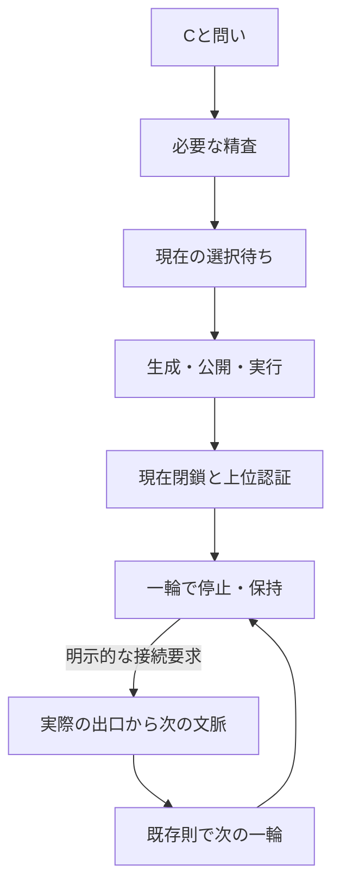

# RR63：一輪を動かし、止め、保持したまま次へ渡す

RR62までに得た演算を、途中で止めて再開できる実行単位にする。**一輪の完了は正常停止。その出口を使う次の一輪は、明示的に接続を要求したときだけ進む。**

基準は `5e0b40871ccda4f0bbf2b6d49b6a9c62d0580bd8`。RR43・RR53・RR56〜62の演算と記録は変更しない。追加するのは段階実行、保存・再開、利用入口である。

## 何がつながったか

1. 3+1を内蔵した既存の入口履歴から開始する。
2. 独立に与えたCと問いに対し、RR62が必要な精査を決める。
3. 成立可否だけなら答えて止まる。作用を求めた場合も、現在が語を選ぶまで止まる。
4. 選ばれた語について、補正の計画、下位セルの実行、作用の公開、各操作、現在セルの閉鎖を順に進める。
5. 実際の出力を指定Cで読み、上位セルのexact成立を別記録に残して止まる。
6. 接続を要求されたら、その実際の出力の順序付き読出しをRR53で次の文脈へ渡し、RR43で次の一輪を動かす。

同じ現在結果と同じ上位結果でも、`HHST` と `HHTS` は実際の履歴が異なる。この差が次の文脈へ届き、次に生成する作用が変わるかを検査する。接続強度を0にする対照でも元の履歴は消さず、文脈への結合だけを切る。



図の最後の循環は接続インターフェースを示す。任意回数の成功や、全体に対する同じCの保証を意味しない。

## 動かす

リポジトリのルートでPythonを使う。Cの座標と係数は整数または分数で指定する。

```sh
python run_live.py start --x=-1 --out .work/live/choice.json
```

`AWAIT_CHOICE`で止まり、checkpointとSHA-256を表示する。以下の`CHOICE_SHA`などは直前に表示された値へ置き換える。

```sh
python run_live.py resume .work/live/choice.json --sha256 CHOICE_SHA --word HHST --out .work/live/closed.json
```

`STOPPED`なら一輪が完了している。初期履歴の一輪を含めて、現在の完了記録は2、stockは6、出力は2、上位認証は1になる。

```sh
python run_live.py resume .work/live/closed.json --sha256 CLOSED_SHA --connect --out .work/live/connected.json
```

検査対象の既定入力では、次の一輪が閉じ、完了記録3、stock7、出力3となる。元の上位認証は1のまま。次の一輪について同じCを認証したとは数えない。

表示中の`word`と`cursor`は、最初に選んだRR62の語とその実行位置を保持する。接続後の輪の語へ読み替えない。後続の実際の操作はengineの完了記録に残る。

`--ticks 1`で一段階だけ実行して保存できる。操作を追加せず`resume`すると、途中ならその続きへ進み、停止中なら停止を維持する。出力先の上書きは拒否する。

成立可否だけを問う例：

```sh
python run_live.py start --x=-1 --query exists --out .work/live/existence.json
```

この入力では`ANSWERED`となり、判定段階の厳密な保持差読出しは0回。作用を選んだり実行したりはしない。後から同じ保存記録へ`--x=-1 --query actions`で問い合わせ直せる。作用の実行が始まった後にCを差し替えることはできない。

## 保存が保持するもの

保存内容は、認証済み入口履歴、現在のengine、要求と判定、語、実行位置、生成中・公開済みの作用、全履歴、上位認証、明示的な入力列である。有理数を厳密に保存し、共有された不変ノードも保つ。pickleや任意クラスの読込みは使わない。

読込みは外部に保持したSHA-256との照合に加え、入力列を既存の純粋な演算で再実行し、保存状態との一致を検査する。**再開は定数時間ではない。** 認証のための再計算を省略したとは主張しない。また、同じファイルからハッシュを計算し直すだけでは、そのファイルの出所を認証したことにはならない。

下位セルを閉じた直後、公開直後、語の途中、上位認証前、停止後、接続途中での再開を検査する。再開後にstockへ二重公開されたり、過去の完了記録が失われたりしないことを確認する。

## 保つ境界

| 項目 | この実装での扱い |
|---|---|
| Cと語の選択 | 利用者からの入力。Cが語を選ぶ機構は追加しない |
| RR62のC | 指定した一操作の上位成立条件。TE全体の無限未来族ではない |
| 次の文脈 | 実際の出口からRR53の既存読出しで作る。anchorと結合強度は既存の設計条件 |
| 次の一輪 | RR43の局所結果`−1`へ閉じる。元のCへの遠未来適合は未検査 |
| 接続時の探索 | 既公開stockの有界な語探索を使う。未来経路列挙をしていないことと、探索が一切ないことは別 |
| 3+1 | 入口の保持差を供給する。各輪で再学習する閉ループは追加していない |
| 性能 | 厳密実行と再開の正しさが対象。長期安定性、総実行時間短縮、保存容量削減は未測定 |
| 未来因果 | 中心仮説を保持。RR61/62の同情報の前向き計算との等価性も維持 |

入口のRR60履歴を偽装して次の輪へ流用することはしない。接続には、実際のlevel3出力であることを検査した小さな読出し用インターフェースを使う。これはRR52の完了証明を新しく発行するものではない。

## 検査

```sh
python integrations/inquiry/validate_live.py
```

[固定入力](../integrations/inquiry/RR63-inputs.json)の範囲で、RR62の一括実行との一致、既存RR53/RR43との一致、保持・消去・復元、順序変更、結合切断、途中保存、改変拒否を検査する。結果は`.work/rr63-local`へ出力する。

2026-10-20の実行では新規14テストが通過した。現在の12例がRR62一括実行と完全一致し、次輪接続6例が既存RR53/RR43の合成と一致した。21か所で保存・復元・次段階の一致を確認し、別プロセスのCLIでも要求から閉鎖・接続まで通した。

既存RR62も別に再実行し、73テストと11検査群が通過、公開済みの結果・開始記録のハッシュと一致した。新規14テストへ重複計上していない。

- [結果とソースハッシュ](../integrations/inquiry/RR63-result.json)
- [検査ログ](../integrations/inquiry/RR63-validation.log)
- [基準版・独立再検証の記録](../integrations/inquiry/RR63-PROVENANCE.json)

この入力表は実装統合の検査範囲を固定するためのもの。既定入力のスモークテスト後に置いており、未知の理論結果を事前登録して発見した扱いにはしない。

**今回の成果は、既に成立した演算を、一輪ずつ実際に扱える形へまとめること。次のCの内生、未知の未来の供給原理、連続学習の完成は、この実行器から自動的には出てこない。**
